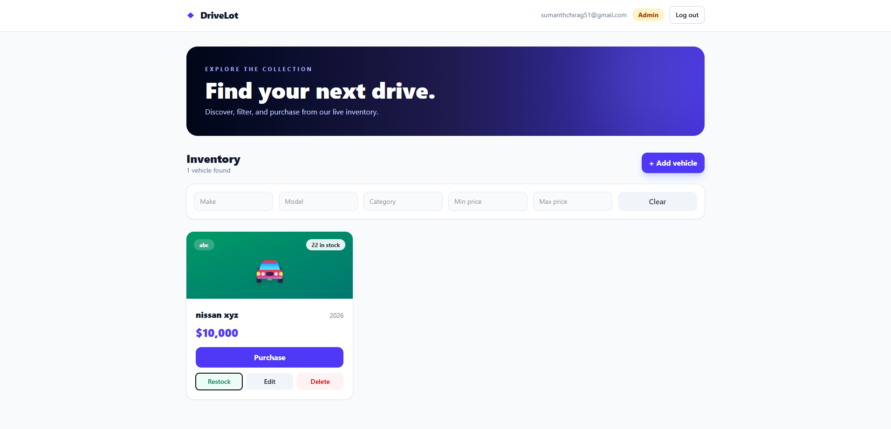
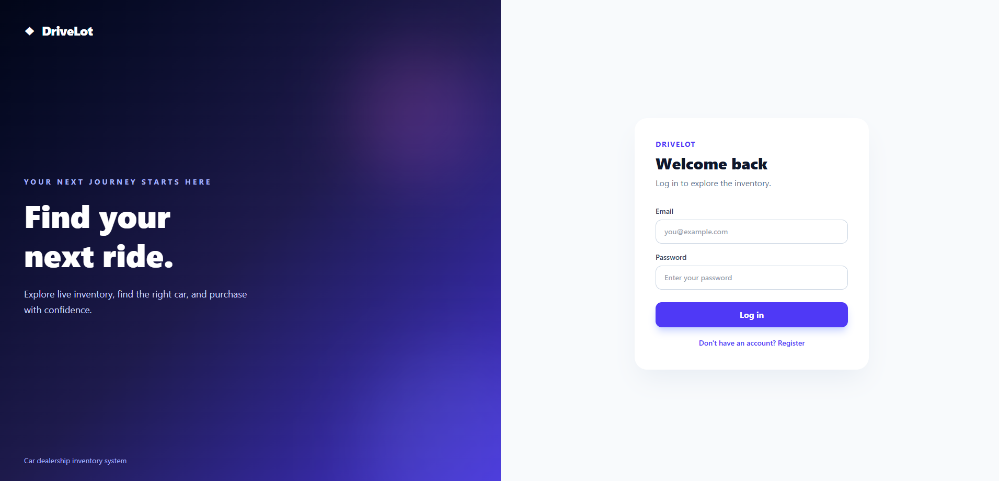

# DriveLot — Car Dealership Inventory System

A full-stack car inventory application with JWT authentication, searchable vehicles, stock purchases, and admin inventory controls.

## Tech stack

- Backend: FastAPI, SQLModel, SQLite, PyJWT, pwdlib
- Frontend: React, Vite, Tailwind CSS
- Tests: pytest with temporary file-backed SQLite databases

## Features

- Register and log in
- Browse and filter vehicles by make, model, category, and price range
- Purchase vehicles while stock is available
- Admin controls for adding, editing, deleting, and restocking vehicles
- Protected API endpoints and admin-only authorization

The API calls the stock quantity `stock`. SQLite data is stored locally in `backend/app.db` and is excluded from Git.

## Run locally

Requirements: Python 3.12+ and Node.js/npm.

### Backend

Open a terminal in `backend`:

```powershell
py -3 -m venv .venv
.\.venv\Scripts\Activate.ps1
python -m pip install -r requirements.txt
$env:JWT_SECRET = python -c "import secrets; print(secrets.token_urlsafe(48))"
python -m uvicorn app.main:app --reload
```

API documentation: http://127.0.0.1:8000/docs

Keep this terminal open. Set `JWT_SECRET` again in each new backend terminal session. Do not commit a real JWT secret.

### Frontend

Open a second terminal in `frontend`:

```powershell
npm install
npm run dev
```

Open http://localhost:5173.

### Create a local admin

Register a normal account in the app. Then, from `backend`, run:

```powershell
.\.venv\Scripts\python.exe -m scripts.make_admin "registered@example.com"
```

Replace the email with the one you registered, then refresh the browser. Public registration cannot assign the admin role.

## API

| Method | Endpoint | Purpose |
| --- | --- | --- |
| POST | `/api/auth/register` | Register |
| POST | `/api/auth/login` | Log in and receive a JWT |
| GET | `/api/auth/me` | Current user |
| POST | `/api/vehicles` | Add a vehicle |
| GET | `/api/vehicles` | List vehicles |
| GET | `/api/vehicles/search` | Filter vehicles |
| PUT | `/api/vehicles/{id}` | Update vehicle details |
| DELETE | `/api/vehicles/{id}` | Delete, admin only |
| POST | `/api/vehicles/{id}/purchase` | Decrease stock |
| POST | `/api/vehicles/{id}/restock` | Increase stock, admin only |

Vehicle routes require a bearer token. Purchase and restock accept a JSON body such as `{"quantity": 1}`.

## Tests

From `backend`, run:

```powershell
.\.venv\Scripts\python.exe -m pytest -q
```

Latest verified backend run: **24 passed, 1 deprecation warning**. See [the test report](test-report.txt). The warning comes from the installed FastAPI/Starlette test client dependency.

## Screenshots





Remove the login image line if you did not save that screenshot.

## My AI Usage

I used **Claude** to help draft tests, backend and frontend code, and implementation guidance, to review requirements, catch missing category/PUT/search functionality, help debug integration errors, and improve the frontend design. I integrated the code, ran the tests locally, fixed errors, and manually checked registration, admin access, purchase, and restock.

AI helped me move quickly and identify gaps, but its output needed checking against the assignment. For example, an initial vehicle implementation omitted required fields and endpoints, so I added tests for those requirements before completing the API. 